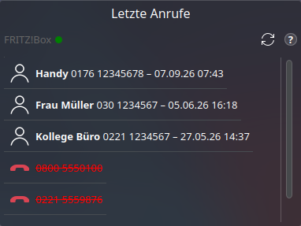
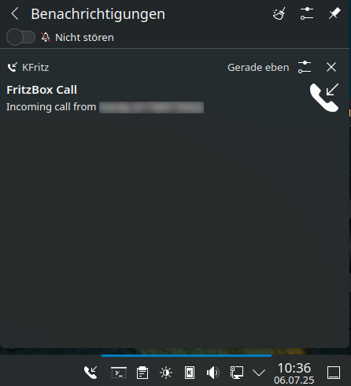
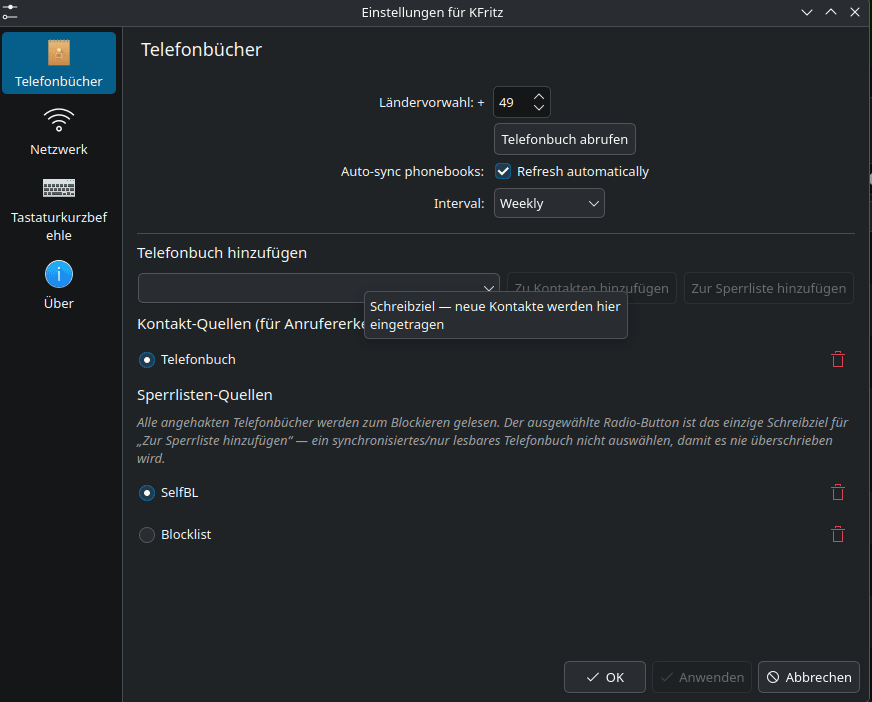

<div align="center">
  
  <h1>KFritz</h1>
  <p>KDE Plasma 6 panel widget for your AVM FRITZ!Box call monitor.</p>
  <a href="https://kde.org/de/">
    
  </a>
  <a href="https://www.gnu.org/licenses/gpl-3.0.html">
    
  </a>
  <a href="https://build.opensuse.org/package/show/home:Agundur/KFritz">
    
  </a>
  <a href="https://paypal.me/agundur">
    
  </a>
</div>

KFritz is a KDE Plasma 6 widget that connects to your AVM FRITZ!Box and
shows real-time incoming calls: caller name and number, call history, and
KDE notifications — with a sound, and quick actions to add unknown callers
to your phonebook or block them.

*(FRITZ!Box is a popular router/modem brand in Germany and other parts of
Europe, with built-in telephony features.)*

If KFritz is useful to you, [support continued KDE/Linux development through GitHub Sponsors](https://github.com/sponsors/Agundur-KDE).

## Visuals





## What it does

- **Real-time call monitoring** via the FritzBox's CallMonitor port.
- **Caller name resolution** from one or more FritzBox phonebooks (TR-064) —
  configure which phonebook(s) to check under Settings › Contacts sources.
- **Blocklist support**: a number found in any configured blocklist
  phonebook is fully silent (no popup, no sound) and shows red/struck-through
  in the call list — instead of a designated "block all numbers" phonebook,
  since AVM's built-in call-barring feature caps out at 32 entries, too few
  for an internet-sourced spam list. Understands AVM's wildcard entries
  (a trailing `*` on a number = prefix match), common in bulk spam lists.
- **Sound + KDE notification** on incoming calls (skipped for blocked ones).
- **Quick actions** on an unrecognized caller: "Add to Contacts" (with a
  name field and number type) or "Add to Blocklist" — each writes to one
  designated phonebook per role, so a WebDAV-synced blocklist that gets
  overwritten on every sync can stay a read-only source while a
  hand-maintained one takes new entries.
- **Missed-call catch-up**: calls that came in while the widget wasn't
  running are fetched from the FritzBox's own call list on startup, with an
  unread-count badge on the panel icon (clears when you open the widget).
- **Phonebook auto-sync**: optionally re-downloads every assigned
  Contacts/Blocklist phonebook on a daily or weekly schedule, so a stale
  local cache doesn't silently miss numbers a WebDAV sync picked up since
  the last manual refresh.
- Optional call OSD above fullscreen applications on Plasma Wayland, with
  configurable font, text color and nine screen positions. The overlay accepts no input
  and disappears after eight seconds; blocked calls never trigger it.
- Compact and full Plasma representations.

## Requirements

- KDE Plasma 6.1+, Qt ≥ 6.7, KDE Frameworks ≥ 6.10, LayerShellQt ≥ 6.1
- A FRITZ!Box with:
  - CallMonitor enabled (see below)
  - TR-064 enabled
  - A user account with phonebook/call-list read permission

## Install

Grab the `.deb`/`.rpm` from the
[latest release](https://github.com/Agundur-KDE/kfritz/releases/latest), or:

Choose the repository for your installed distribution. Add it only once; the same repository provides the other Agundur packages too.

**openSUSE Tumbleweed:**

```bash
sudo zypper ar -f https://download.opensuse.org/repositories/home:/Agundur/openSUSE_Tumbleweed/home:Agundur.repo
sudo zypper --gpg-auto-import-keys ref
sudo zypper in kfritz
```

**openSUSE Leap 16.1:**

```bash
sudo zypper ar -f https://download.opensuse.org/repositories/home:/Agundur/16.1/home:Agundur.repo
sudo zypper --gpg-auto-import-keys ref
sudo zypper in kfritz
```

**openSUSE Leap 16.0:**

```bash
sudo zypper ar -f https://download.opensuse.org/repositories/home:/Agundur/16.0/home:Agundur.repo
sudo zypper --gpg-auto-import-keys ref
sudo zypper in kfritz
```

**openSUSE Slowroll (x86_64):**

```bash
sudo zypper ar -f https://download.opensuse.org/repositories/home:/Agundur/openSUSE_Slowroll/home:Agundur.repo
sudo zypper --gpg-auto-import-keys ref
sudo zypper in kfritz
```

```bash
# Debian 13 (Trixie) / compatible — download the .deb from the release page, then:
sudo apt install ./kfritz_*.deb
```

Unlike the other Agundur-KDE plasmoids, KFritz has a real compiled C++
plugin (phonebook/TR-064 handling), so there's no `.plasmoid`/GHNS install —
building from source needs the full toolchain:

```bash
git clone https://github.com/Agundur-KDE/kfritz.git
cd kfritz
mkdir build && cd build
cmake .. -DCMAKE_BUILD_TYPE=Release
make
sudo make install
```

## Tested Hardware/Software

FritzOS 7.57 and 8.03.

🛒 [FRITZ!Box 6690 Cable](https://www.amazon.de/s?k=FRITZ%21Box+6690+Cable)
🛒 [FRITZ!Box 6660 Cable](https://www.amazon.de/s?k=FRITZ%21Box+6660+Cable)

## FritzBox Setup

KFritz uses two interfaces of the FRITZ!Box:
- The CallMonitor on port 1012 for incoming call events
- The TR-064 API for phonebook name resolution, blocklist checks, and
  the "Add to Contacts"/"Add to Blocklist" actions

### Enable CallMonitor

Connect a telephone to your FRITZ!Box (DECT handset or analog), then dial:

```
#96*5*
```

This enables the call monitor on port 1012 (persists across reboots).
To disable it again: `#96*0*`.

### Enable TR-064

Newer FritzOS versions don't have a separate "allow TR-064" toggle anymore —
it's available as soon as a FRITZ!Box user with the right permission (below)
exists. Older versions: FRITZ!Box web interface (`http://fritz.box`) →
Home Network › Network › Network Settings → "Allow access for applications
(TR-064)".

### Create a dedicated user

System › FRITZ!Box Users → Add User:
- Username: `kfritz` (recommended)
- Permissions: **only** "Sprachnachrichten, Faxnachrichten, FRITZ!App Fon
  und Anrufliste" ("Voice messages, faxes, FRITZ!App Fon and call list") —
  don't grant "FRITZ!Box Settings", it's not needed and is full admin access.

This user authenticates KFritz's TR-064 calls (phonebook download, blocklist
checks, adding contacts). Run `./setup_test.sh` (see below) to verify the
permission is actually sufficient before filing a bug.

## Configuration

Right-click the widget → Configure KFritz:

- **Network**: Host (usually `192.168.178.1`), Port (`49000` default),
  Username/Password (the dedicated user created above)
- **Phonebook**: country code, then assign one or more downloaded
  phonebooks to the "Contacts" role (used for caller ID) and/or the
  "Blocklist" role (checked first on every call) — each role has one
  designated write target for the quick-action buttons

- **OSD**: enable the additional call overlay, choose its font (including
  size and style), text color and position. It is off by default and requires Wayland.
  Standard KDE notifications and sounds continue to work. Use "Test OSD" to preview the current settings immediately, even before
  applying them. The overlay uses the active
  screen; visibility and input behavior should be checked with your game.

Only needs to be done once, settings persist across reboots.

## Troubleshooting

Before filing a bug, run the included diagnostic script — it checks the
CallMonitor port, the TR-064 port, and phonebook/call-list access against
your box directly, independent of the widget. No need to clone the whole
repo, download it directly:

```bash
curl -O https://raw.githubusercontent.com/Agundur-KDE/kfritz/main/setup_test.sh
chmod +x setup_test.sh   # a plain download doesn't carry the executable bit

./setup_test.sh
# or non-interactively: ./setup_test.sh <host> <login> <password>
```

`errorCode 502 "XML error"` on the phonebook/call-list check, even with
correct permissions, usually means the box isn't actually handling telephony
— e.g. it's running as a Mesh repeater / IP-client (DECT only) while a
third-party VoIP provider (Sipgate etc.) handles calls elsewhere. AVM's
`X_AVM-DE_OnTel` service isn't active on that box in that case; this isn't a
KFritz bug.

## Support

Open an issue: [KFritz Issues](https://github.com/Agundur-KDE/kfritz/issues)

## Contributing

Fork and adapt freely.

After changing translatable text, run `bash Messages.sh`, update every
shipped language catalog and run `bash tools/check-translations.sh`. The
check rejects missing, untranslated or fuzzy entries and invalid formats.

## License

GPL-3.0-or-later

## Incoming Android calls with ScreenRing Phone

**New in KFritz 0.5.0:** show incoming cellular-call alerts from your Android phone
on the KDE Plasma desktop, alongside the existing direct FRITZ!Box monitor.
The phone and desktop must be reachable on your local network. No conversation
audio is sent and there is no developer cloud account.

**[Download ScreenRing Phone APK](https://github.com/Agundur-KDE/ScreenRing-Phone/releases/tag/v0.6.0-alpha.2)**
· [Setup and screenshots](https://github.com/Agundur-KDE/ScreenRing-Phone#readme)
· [German setup](https://github.com/Agundur-KDE/ScreenRing-Phone/blob/main/INSTALL.de.md)
· [Share your experience](https://github.com/Agundur-KDE/ScreenRing-Phone/discussions/1)

Already using the Android companion? Tell us what worked and what did not in the
linked discussion. App/KFritz versions and general device/software details help;
never post real caller data, pairing keys or unredacted screenshots. Reports are
voluntary feedback, not installation tracking or an endorsement requirement.

The Android companion is a separately distributed signed **alpha**. It is not
bundled into the Linux package. KFritz **0.4.1 and earlier do not contain this
receiver**; install KFritz 0.5.0 or newer first. The Android application source is
not included here. KFritz itself remains GPL-3.0-or-later.

### Pair your phone

1. In KFritz **Settings → Mobile calls**, enable reception, generate a pairing
   key and save. Reception is disabled by default.
2. In ScreenRing Phone, enable the **KFritz/desktop** destination and enter your
   computer's local IP address, port (default **10123**) and the pairing key.
3. Grant Android phone-state permission, start forwarding and send a **test**.
   Keep the computer running and reachable. If a firewall blocks the connection,
   allow the configured TCP port only on your trusted home-network zone.

Caller number and local contact name are optional and encrypted in transit.
Without those permissions, KFritz receives a generic incoming-phone alert.
Mobile calls use their own source in recent history, normal notifications/OSD
and configured blocklists when a number is available. Repeated updates do not
create duplicate history entries. This feature cannot answer or hang up calls.

The pairing key is private; do not paste it into public issues or screenshots.
Name, number and phone label are encrypted; device/call identifiers and event
kind remain visible in protocol headers. The receiver uses bounded connections,
fresh challenges and message-bound authenticated acknowledgements. Older peers
replying with bare `OK` are incompatible; update both endpoints together.

FRITZ!Box landline monitoring does **not** require ScreenRing Phone. The phone
can also pair independently with ScreenRing TV, a separate planned Google Play
app; KFritz is the desktop receiver, not a required relay for TV.

See [protocol details](docs/screenring-protocol.md). OpenSSL Crypto is an additional
build dependency. Development checks:

```sh
cmake -S . -B build -DBUILD_TESTING=ON
cmake --build build --parallel 2
ctest --test-dir build --output-on-failure
```
